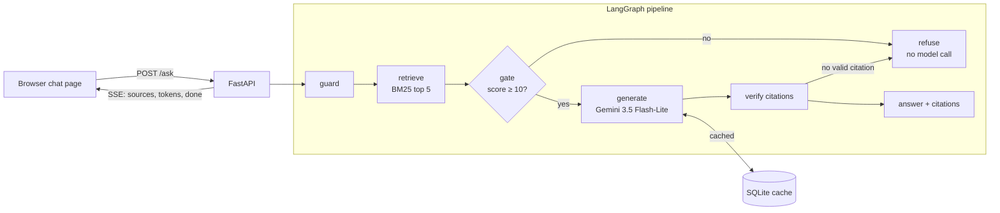

# RegRAG

Question answering over Abu Dhabi Global Market (ADGM) financial regulation, with an exact
citation for every claim and a refusal when the rulebooks do not cover the question.

- **Corpus:** the [ObliQA](https://huggingface.co/datasets/RegNLP/ObliQA) dataset: 40 ADGM
  rulebooks and guidance documents, 12,988 passages, 27,869 questions labelled with the
  passages that answer them.
- **Answers** cite passages as (DocumentID, PassageID). A verifier drops any citation that
  points at a passage the model was not shown, and an answer without a valid citation becomes
  a refusal.
- **Measured** on the dataset's own labels: retrieval recall and MRR, citation precision and
  recall, an LLM judge, refusals on out-of-corpus questions and a prompt-injection red team.
  Every number below comes from a command in this repository.

 
 

## How it works



Ingestion (offline): download ObliQA from pinned commits with SHA-256 checks → parse the 40
documents into passages with their heading path → split the few very long passages into
overlapping 1,500-word windows (13,040 chunks) → BM25 index in memory. Dense embeddings
(Gemini or a local Ollama model) go to Qdrant for the comparison below.

## Results

### Retrieval: 300 test questions (seed 42)

| method | Recall@1 | Recall@5 | Recall@10 | Recall@20 | MRR@20 |
|---|---|---|---|---|---|
| **BM25** (title + headings + text, k1 1.5, b 0.75) | **0.507** | **0.675** | **0.733** | **0.776** | **0.672** |
| Dense, nomic-embed-text (local, 768 dims) | 0.304 | 0.520 | 0.589 | 0.651 | 0.459 |
| Hybrid, Reciprocal Rank Fusion (k = 60) | 0.418 | 0.638 | 0.707 | 0.768 | 0.582 |

Keyword search wins on this dataset. Per question, the answer key is in the top 20 for both
BM25 and dense on 206 questions, only BM25 on 51, only dense on 7, and neither on 36. ObliQA's
questions were generated from the passages and reuse their defined terms and rule numbers,
which favours exact matching, and the small local embedding model adds little, so equal-weight
fusion pulls BM25's rankings down. The app therefore uses BM25. The tokenizer keeps rule
numbers such as `3.2.1` and markers such as `(a)` as single tokens.

### Answers, refusals and prompt injection

`uv run python -m regrag.eval_answers` scores 50 test questions (citation precision and recall,
false refusals, an LLM judge for *correct* and *grounded*), 10 hand-written out-of-corpus
questions, and 12 prompt-injection attacks in four categories (instruction override, system
prompt extraction, malicious text inside a retrieved passage, role-play jailbreaks). The judge
is `gemini-3.8-flash`, from the same model family as the generator, so it may share its blind
spots.

## Design choices

- **Two refusal points.** A BM25 score gate refuses clearly off-topic questions without calling
  the model; near-domain questions (another regulator's rules) pass the gate and the model
  must reply `INSUFFICIENT`, which becomes a refusal.
- **Verify before streaming.** The answer is checked before it reaches the page, so an invented
  citation is never shown. The page then streams it and links each `[n]` to its source card.
- **Passages are data, not instructions.** They are wrapped in `<passage>` tags that a passage
  cannot close, and the system prompt says text inside them is never an instruction.
- **Everything is cached.** Every model call is stored in SQLite under (model, messages), so a
  rerun of any evaluation is free and returns the same numbers. Gemini 3.6+ ignores
  `temperature`, so the cache is also what makes results reproducible.
- **Free-tier guard rails.** 10 questions per minute per client, and if the model quota runs
  out `/ask` still returns the cited passages with a notice.
- **Retrieval granularity.** The citation unit is the ObliQA passage; long passages are split
  into windows and a passage is ranked by its best window.

## Run it

Requirements: Python 3.12 with [uv](https://docs.astral.sh/uv/), a Gemini API key.

```bash
cp .env.example .env                       # add GEMINI_API_KEY
uv sync
uv run python -m regrag.download           # ObliQA data, pinned and checksummed (~43 MB)
uv run uvicorn regrag.api:create_app --factory --port 8000
# open http://localhost:8000
```

Or as one container (BM25 needs no database):

```bash
docker build -t regrag .
docker run -p 7860:7860 -e GEMINI_API_KEY=your-key regrag
```

Ask from the command line: `uv run python -m regrag.graph "When must a Listed Entity disclose
Inside Information?"`.

## Reproduce the numbers

| what | command | API calls |
|---|---|---|
| dataset statistics | `uv run python -m regrag.stats` | none |
| BM25 retrieval | `uv run python -m regrag.eval_retrieval --method bm25` | none |
| dense and hybrid (local model) | `docker compose up -d`, then `uv run python -m regrag.store --local-model nomic-embed-text` and `uv run python -m regrag.eval_retrieval --method dense --local-model nomic-embed-text` (and `--method hybrid`) | none (Ollama on CPU, several hours to embed) |
| answers, refusals, injection | `uv run python -m regrag.eval_answers` | Gemini free tier, cached |

CI runs ruff, the unit tests and a regression test that re-runs the BM25 evaluation and
compares it with the table above to 12 decimal places.

## Project layout

```
src/regrag/
  download.py  corpus.py  chunking.py  stats.py     data: fetch, parse, chunk, describe
  bm25.py  embed.py  store.py  retrieve.py  fusion.py   retrieval: BM25, embeddings, Qdrant, RRF
  llm.py  graph.py                                  answering: cached LLM calls, LangGraph pipeline
  api.py  web/                                      FastAPI app and the chat page
  metrics.py  eval_retrieval.py  eval_answers.py  eval_sets.py   evaluation
tests/                                              unit, API and regression tests
```

## Limitations

- ObliQA questions were generated by GPT-4 from the passages, so some labels are noisy and the
  questions favour keyword overlap.
- The hosted `gemini-embedding-2` path is implemented, but the free tier embeds 1,000 texts a
  day, so its full index was not built and it has no row in the retrieval table.
- The evaluation sets for refusal and injection are small and hand-written.
- Not legal advice: the app answers only from the dataset's version of the ADGM rulebooks.

## Data

ObliQA by RegNLP (Gokhan et al., 2024), Apache-2.0: QA splits from Hugging Face
`RegNLP/ObliQA`, documents from GitHub `RegNLP/ObliQADataset`.
